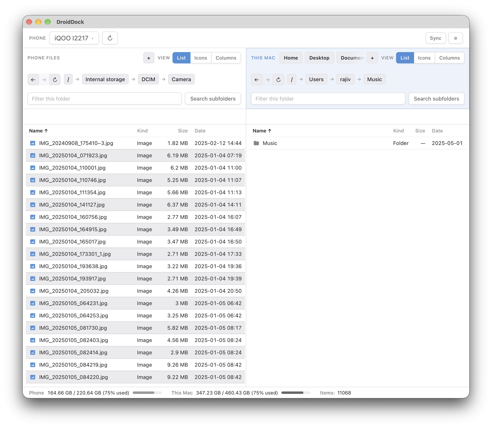
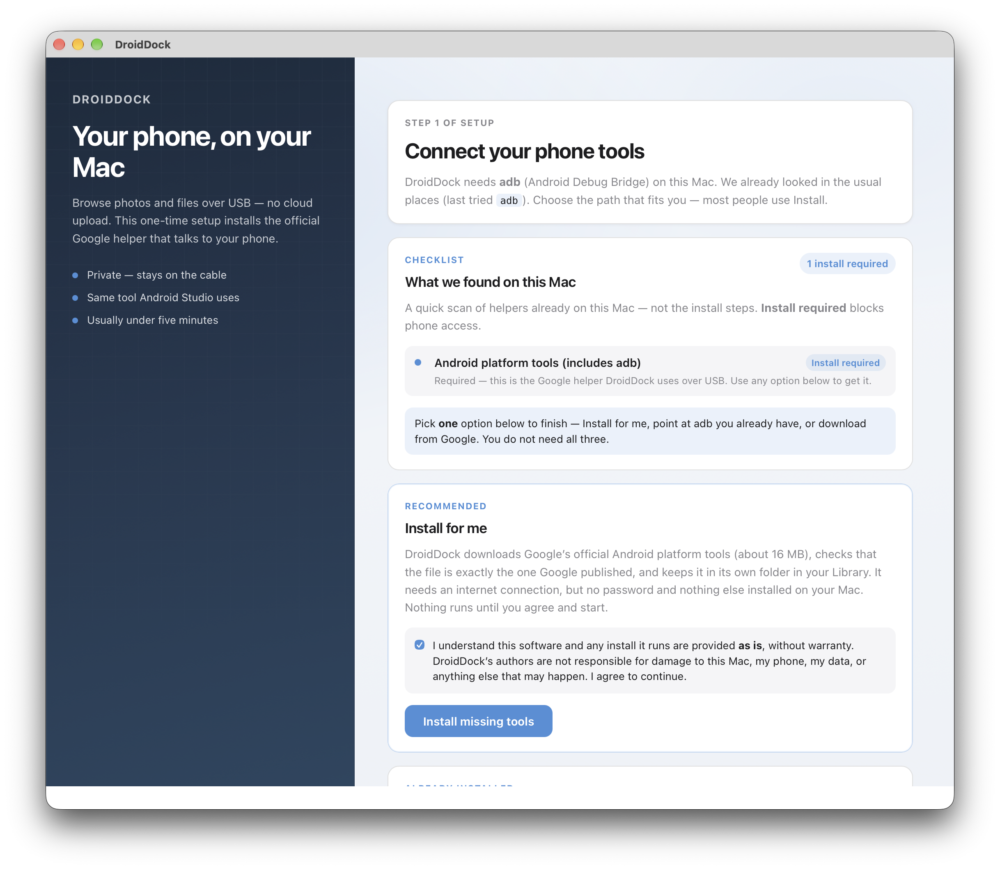
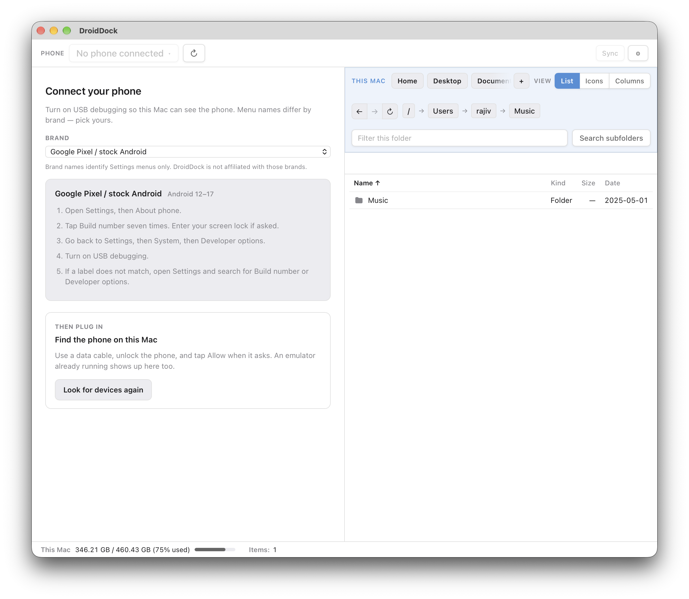
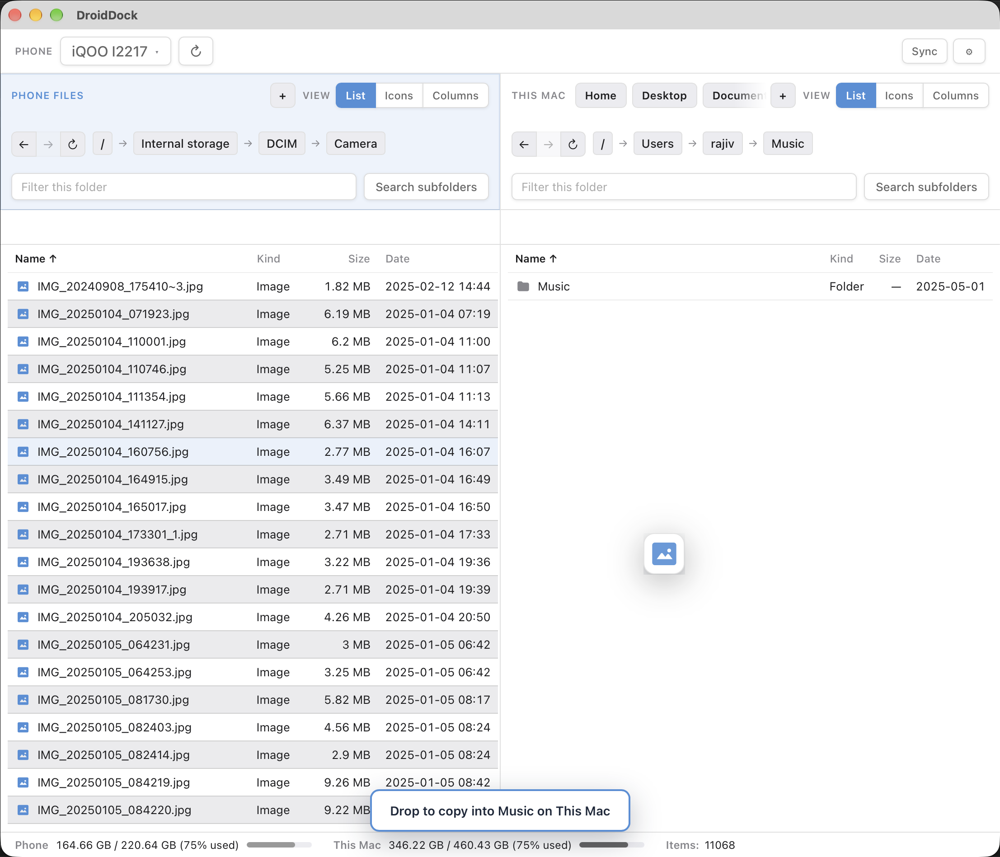

# DroidDock

Copy files between an Android phone and a Mac over USB. Both sit side by side, a copy goes either way, and nothing is uploaded to a cloud.

🌐 **[Visit DroidDock Website](https://rajivm1991.github.io/DroidDock/)**

[](https://github.com/rajivm1991/DroidDock/releases/latest)
[](https://github.com/rajivm1991/DroidDock/releases)
[](https://github.com/rajivm1991/DroidDock/actions)
[](LICENSE)
[](https://github.com/rajivm1991/DroidDock/releases/latest)
[](https://github.com/rajivm1991/DroidDock)
[](https://www.buymeacoffee.com/rajivm1991)



## Get the app

```bash
brew tap rajivm1991/droiddock
brew install --cask droiddock
```

Or download the latest `.dmg` from [Releases](https://github.com/rajivm1991/DroidDock/releases/latest) and drag DroidDock into Applications. If macOS says the app is
damaged, see [the fix](#macos-says-droiddock-is-damaged).

Open it and follow the screen. You do this once: install adb with one click, turn on USB debugging on the phone, plug in, and tap Allow.

## What you'll see

_One click installs Google’s adb tool. No password, no Homebrew._



_No phone yet: pick your brand for the USB debugging steps._



_Drag between the two sides to copy either way._



## Features

- Phone and This Mac side by side. Copy with drag, Cmd+C / Cmd+V, Cmd+D, or by dropping a file from Finder onto the phone side
- List, Icons, and Columns views, one per side
- Transfer queue with progress, pause, cancel, and retry. A replace keeps the original until the new copy finishes
- Skip, replace, keep both, or ask each time when names clash. Folders can merge
- Folder sync with a preview. Compare by name and date or by content, filter by pattern, and save setups
- Preview a phone file with Space. Thumbnails for photos and videos
- Filter the open folder, or search the folders inside it
- Rename, new folder, and delete. Delete asks first, and critical system folders are blocked
- Place marks, back and forward, and clickable breadcrumbs
- USB debugging steps for your phone's brand
- Light, dark, or match the Mac

**USB debugging is safe.** It does not root the phone, void the warranty, or put the phone on the internet. DroidDock does not collect your files, and its only download
is Google's platform-tools, once, when you click Install.

## Keyboard shortcuts

Cmd+/ shows the full list in the app. Shortcuts follow the active side.

| Shortcut              | Action                                                      |
| --------------------- | ----------------------------------------------------------- |
| `Ctrl + Tab`          | Switch the active side                                      |
| `Cmd + 1` `2` `3`     | List, Icons, Columns                                        |
| `Cmd + C` / `Cmd + V` | Remember the selection / paste into the other side's folder |
| `Cmd + D`             | Copy the selection into the other side's folder             |
| `Cmd + A`             | Select all visible files                                    |
| `Cmd + F`             | Focus the filter                                            |
| `Space`               | Preview the focused phone file                              |
| `Return`              | Open the focused folder                                     |
| `Cmd + Return`        | Rename on the phone                                         |
| `Delete`              | Go to the parent folder (it never deletes files)            |
| `Cmd + [` / `Cmd + ]` | Back / forward                                              |
| `Cmd + I`             | Folder sync                                                 |
| `Cmd + ,`             | Settings                                                    |
| `Cmd + T`             | Toggle thumbnails                                           |
| `Cmd + Shift + .`     | Toggle hidden files                                         |

## Troubleshooting

### macOS says DroidDock is "damaged"

DroidDock is not signed with an Apple Developer ID yet, so Gatekeeper flags the download. Run this once, then open the app normally:

```bash
xattr -cr /Applications/DroidDock.app
```

### Setup can't install adb

Check your internet connection and click Install again. If it says the file "did not match what Google published", nothing was installed, so try again. Or choose an `adb`
you already have, or use the **Download from Google instead** steps on the setup screen.

### The phone isn't showing up

Use a data cable, unlock the phone, and tap Allow. Then click Look for phones. The phone side shows the USB debugging steps for your brand.

### This Mac shows "Allow access"

macOS blocks some folders, such as Desktop, Documents, and Downloads. Allow it when asked, or add DroidDock under Full Disk Access in System Settings.

### "Not supported on this Mac"

DroidDock needs **macOS 10.15 (Catalina) or later**, on Intel or Apple Silicon. Right-click the app and choose Open, or run the `xattr` command above. If it persists,
[open an issue](https://github.com/rajivm1991/DroidDock/issues) with your Mac model and macOS version.

### A folder won't open

Double-click it (or single-click, if Settings says so). One click only selects it.

## Support

[Open an issue](https://github.com/rajivm1991/DroidDock/issues) if something is wrong. DroidDock is free and open-source, made by one developer in their spare time.
If it saves you time: ☕ **[buymeacoffee.com/rajivm1991](https://www.buymeacoffee.com/rajivm1991)**

---

## Developer Guide

Everything below is for people building, contributing to, or releasing DroidDock.

### Prerequisites

[Node.js](https://nodejs.org/) 20.19+ or 22.12+, and [Rust](https://rustup.rs/). You don't need adb first: the setup screen downloads Google's platform-tools. DroidDock
looks for `adb` in this order:

- `/opt/homebrew/bin/adb`, `/usr/local/bin/adb`, `/opt/local/bin/adb`
- `~/Library/Android/sdk/platform-tools/adb`, `~/Android/Sdk/platform-tools/adb`
- `~/Library/Application Support/DroidDock/platform-tools/adb` (the downloaded copy, used last)
- `adb` on your `PATH`

### Build from Source

```bash
git clone https://github.com/rajivm1991/DroidDock.git
cd DroidDock
npm install
npm run tauri dev     # development, with hot reload
npm run tauri build   # production build, in src-tauri/target/release/bundle/
```

### Project Structure

```
DroidDock/
├── src/             # React + TypeScript frontend (components, hooks, lib, types, styles)
├── src-tauri/src/   # Rust backend: adb, local, media, phone, setup, sync, transfer
├── scripts/         # release-prepare.cjs
└── docs/            # GitHub Pages website and screenshots
```

| Backend module | What it does                                                            |
| -------------- | ----------------------------------------------------------------------- |
| `adb`          | Finds and validates `adb`, and lists connected devices                  |
| `phone`        | Lists, searches, renames, and deletes on the phone, and reports storage |
| `local`        | The same for This Mac, plus Finder and permission helpers               |
| `transfer`     | Copies a file either way with a temp file, progress, and cancel         |
| `sync`         | Scans both sides, plans and runs a sync, and stores saved syncs         |
| `media`        | Thumbnails and previews                                                 |
| `setup`        | Checks `adb` and downloads and verifies Google's platform-tools         |

The Tauri commands are registered in `src-tauri/src/lib.rs`.

### Tests

```bash
cd src-tauri && cargo test               # Rust tests
cd src-tauri && cargo test -- --ignored  # also downloads the pinned platform-tools from Google
```

There is no frontend test runner. `npm run build` type-checks the frontend with `tsc`.

### Updating the pinned platform-tools

Change `PLATFORM_TOOLS_URL` and `PLATFORM_TOOLS_SHA256` in `src-tauri/src/setup/mod.rs`. Get the hash with `shasum -a 256` on the downloaded zip, compare it with the
checksum in Google's SDK manifest (`https://dl.google.com/android/repository/repository2-3.xml`), then run the `--ignored` test above.

### Releases

```bash
npm run release:prepare <version>   # bumps versions, updates CHANGELOG.md, commits, and tags
git push origin <branch-name>
git push origin v<version>
```

Pushing the tag runs `.github/workflows/release.yml`, which builds a universal macOS binary (Apple Silicon and Intel), creates a DMG, and publishes a GitHub Release.

### Website

Preview `docs/index.html` locally with `cd docs && python3 -m http.server 8080`, then open http://localhost:8080.

### Contributing

Pull requests are welcome. Fork the repo, create a feature branch, commit, push, and open a pull request.

### License

MIT — see [LICENSE](LICENSE).

### Acknowledgments

Built with [Tauri](https://tauri.app/). Talks to the phone through `adb` from Google's [Android SDK Platform-Tools](https://developer.android.com/tools/releases/platform-tools),
which DroidDock downloads but does not bundle.

Thanks to [PROSKEY](https://github.com/PROSKEY) for the phone-and-Mac window, copy either way, the transfer queue, and the setup and USB debugging screens.
